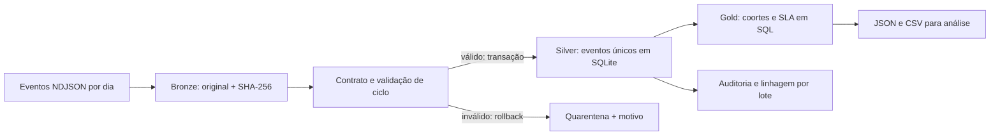

# TrustFlow

**Engenharia de dados para acompanhar operações de assinatura digital.**

[](https://github.com/felipercmb/trustflow-data-pipeline/actions/workflows/ci.yml)


Um fluxo de assinatura começou, falhou, ficou pendente ou foi concluído? Quanto tempo levou? O prazo de atendimento foi cumprido? O TrustFlow transforma eventos de aplicações em indicadores auditáveis, preservando a origem de cada registro e permitindo repetir uma carga sem duplicar resultados.

**Projeto independente de portfólio.** Todos os eventos e resultados demonstrados são **sintéticos**, gerados por código. Não há dados de clientes, integração com a Soluti, vínculo comercial ou alegação de resultados reais.

## Por que este domínio?

O [portfólio público da Soluti](https://soluti.com.br/) inclui identidade digital, certificados e a plataforma IntelliSign para assinaturas e gestão de documentos. O projeto explora uma necessidade plausível desse setor: transformar eventos operacionais em visibilidade sobre tempo de conclusão, falhas e filas de atendimento. Essa é uma hipótese de aplicação, não uma descrição dos sistemas internos da empresa.

A proposta demonstra competências de engenharia de dados — Python, SQL, automação, modelagem, qualidade, rastreabilidade e testes — sem presumir a stack ou os requisitos completos de uma vaga. Veja [contexto, fontes e limites](docs/contexto-e-fontes.md).

## Execute em três comandos

Requer Python **3.11 ou superior**, com SQLite disponível. A execução local e os testes usam apenas a biblioteca padrão: **sem API, credencial, serviço de nuvem ou instalação de dependências**.

```bash
git clone https://github.com/felipercmb/trustflow-data-pipeline.git
cd trustflow-data-pipeline

python3 -m trustflow generate-demo --output data/demo
python3 -m trustflow ingest data/demo
python3 -m trustflow report --as-of 2025-01-16T00:00:00Z --output reports/demo
```

Use `python` se esse for o nome do Python 3 no seu sistema. O gerador recusa sobrescrever uma pasta não vazia; para repetir a **carga**, execute novamente apenas `ingest`. Para gerar outro cenário, escolha uma nova pasta e outro `--data-dir`.

Arquivos produzidos:

| Local | Conteúdo |
|---|---|
| `data/demo/*.ndjson` | Eventos sintéticos particionados por dia UTC |
| `data/local/bronze/` | Bytes originais, identificados por SHA-256 |
| `data/local/warehouse.sqlite` | Eventos validados e auditoria das cargas |
| `data/local/quarantine/` | Motivo da rejeição e referência ao arquivo original |
| `reports/demo/report.json` | Indicadores, contexto e qualidade |
| `reports/demo/cohorts.csv` | Indicadores por data de solicitação, prontos para BI |

## Uma demonstração verificável

Com `--seed 42 --count 240` e observação em `2025-01-16T00:00:00Z`, a execução gera **441 eventos em 15 partições**, referentes a **240 fluxos sintéticos**. O [JSON completo](examples/demo-report/report.json) e o [CSV](examples/demo-report/cohorts.csv) foram produzidos pelo próprio pipeline:

| Resultado sintético | Quantidade |
|---|---:|
| Fluxos solicitados | 240 |
| Concluídos com assinatura | 139 |
| Falhos | 42 |
| Cancelados | 8 |
| Expirados | 12 |
| Ainda pendentes | 39 |

O SLA demonstrativo é de **3.600 segundos**, uma escolha didática, não um compromisso de serviço de qualquer empresa. Nessa amostra, 41 de 240 solicitações elegíveis foram assinadas dentro dele (17,08%). As distribuições foram escolhidas para exercitar cenários; não estimam desempenho, demanda ou participação de mercado.

## Arquitetura



- **Contrato explícito:** UUIDs, campos permitidos, versão, categorias e timestamps com fuso horário. Campos extras são rejeitados.
- **Idempotência:** `event_id` identifica o evento; o hash do payload normalizado distingue duplicatas de conflitos. Replays preservam fatos e linhagem original.
- **Atomicidade por arquivo:** qualquer erro invalida o lote completo. Arquivos anteriores já aceitos continuam válidos.
- **Eventos atrasados:** um evento terminal pode chegar antes da solicitação. Fica visível como `awaiting_request` até a reconciliação.
- **Tempo de evento:** relatórios usam `--as-of`, evitando que um resultado futuro apareça numa observação passada.
- **Observabilidade:** logs JSON, contadores de linhas, estados dos lotes e diagnóstico de rejeição sem repetir valores recebidos.

O [desenho técnico](docs/arquitetura.md) explica os limites de concorrência, armazenamento e evolução.

## Indicadores com definição clara

| Indicador | Definição |
|---|---|
| Solicitados | Fluxos com `requested` observado até `as_of` |
| Pendentes | Solicitação observada sem estado terminal observado |
| Pendentes com prazo atingido | Pendentes cuja idade é maior ou igual ao SLA |
| SLA cumprido (%) | Solicitações elegíveis assinadas dentro do prazo ÷ solicitações com idade maior ou igual ao SLA |
| Tempo médio e p95 | Duração de fluxos assinados; p95 pelo método *nearest rank* |
| Falhas por código | Eventos `failed` observados, incluindo os que aguardam solicitação |

Coortes usam a **data UTC da solicitação**, não a data de ingestão. Solicitações recentes ficam fora do denominador de SLA; falhas, cancelamentos e expirações elegíveis permanecem nele. Denominador zero produz `null`. [Dicionário e exemplos](docs/metricas.md).

```bash
# Apenas o canal API
python3 -m trustflow report --as-of 2025-01-16T00:00:00Z --channel api --output reports/api

# Reprocessamento: zero inserções novas, 441 duplicatas reconhecidas
python3 -m trustflow ingest data/demo

# Outro SLA usa um warehouse separado
python3 -m trustflow ingest data/demo --data-dir data/sla-30m --sla-seconds 1800
```

## Testes e automação

```bash
python3 -m unittest discover -s tests -v
```

Os testes cobrem contrato, fusos, precisão do prazo, duplicatas, conflitos, rollback, integridade do bruto, eventos atrasados, métricas conhecidas e a jornada completa offline. A CI executa a suíte em Python 3.11, 3.12, 3.13 e 3.14 e verifica a instalação do pacote.

Em **Actions → Synthetic demo → Run workflow**, a automação gera eventos, carrega, verifica o replay e exporta relatórios como artefatos com retenção de sete dias. Ela é manual e não consulta sistemas externos. Não há job de produção agendado.

Instalação opcional do comando `trustflow` em ambiente virtual:

```bash
python3 -m venv .venv
.venv/bin/python -m pip install .
.venv/bin/trustflow --help
```

O empacotamento pode baixar o backend `setuptools`; isso não é necessário para executar a aplicação diretamente do checkout.

## Navegue pelo projeto

| Arquivo | Responsabilidade |
|---|---|
| [contract.py](trustflow/contract.py) | Contrato e normalização |
| [pipeline.py](trustflow/pipeline.py) | Transação, deduplicação e reconciliação |
| [storage.py](trustflow/storage.py) | Bronze imutável e conexão analítica |
| [cohort_metrics.sql](trustflow/sql/cohort_metrics.sql) | Indicadores por coorte e percentil |
| [report.py](trustflow/report.py) | Consulta consistente e exportação |
| [demo.py](trustflow/demo.py) | Geração sintética reproduzível |
| [tests/](tests/) | Casos unitários e de integração |
| [Operação](docs/operacao.md) | Replay, rejeições e recuperação |
| [Contrato](docs/contrato.md) | Campos, estados e regras |

## Escopo e evolução

É um pipeline batch local, com um escritor SQLite por vez, lotes de até 10 MiB e 50 mil linhas. Não realiza assinaturas, validação criptográfica, emissão/revogação de certificados, identificação de pessoas ou análise jurídica. `signed` é um evento informado pela origem, não uma prova de assinatura válida.

Próximas extensões possíveis: adaptador autenticado de uma fonte autorizada, armazenamento de objetos, processamento incremental em warehouse, orquestração e alertas. Nenhuma está implementada ou é apresentada como implantada em produção. [Decisões e evolução](docs/arquitetura.md#evolucao).

Código e exemplos sintéticos sob a [licença MIT](LICENSE).
