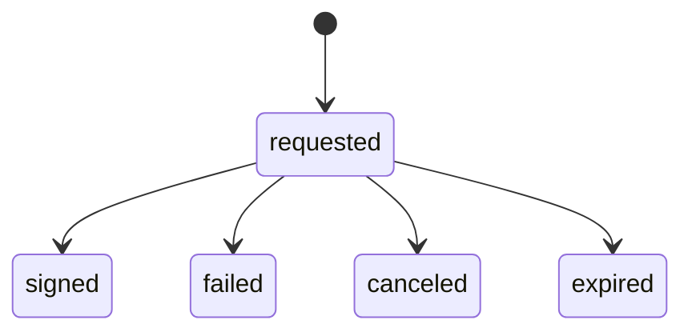

# Contrato de eventos v1

Uma linha UTF-8 contém exatamente um objeto JSON. Um arquivo é uma unidade atômica de ingestão. Linhas vazias, JSON inválido, chaves repetidas e campos adicionais rejeitam o lote inteiro.

```json
{
  "schema_version": 1,
  "event_id": "11111111-1111-4111-8111-111111111111",
  "workflow_id": "22222222-2222-4222-8222-222222222222",
  "event_type": "requested",
  "occurred_at": "2025-01-01T10:00:00-03:00",
  "channel": "api",
  "document_type": "contract",
  "failure_code": null,
  "dataset_kind": "synthetic"
}
```

| Campo | Regra |
|---|---|
| `schema_version` | Inteiro `1`; booleanos e `1.0` são inválidos |
| `event_id` | UUID canônico em minúsculas; chave de idempotência |
| `workflow_id` | UUID canônico; identifica um fluxo, não uma pessoa ou documento |
| `event_type` | `requested`, `signed`, `failed`, `canceled`, `expired` |
| `occurred_at` | Data/hora com segundos e fuso explícito; até seis casas decimais |
| `channel` | `api`, `web`, `mobile` |
| `document_type` | `contract`, `authorization`, `service_order` |
| `failure_code` | Obrigatório em `failed`: `TIMEOUT`, `PROVIDER_UNAVAILABLE` ou `INVALID_DOCUMENT`; `null` nos demais |
| `dataset_kind` | `synthetic` ou `operational`, igual à configuração do warehouse |

## Semântica de estado



`expired` significa que **o fluxo de assinatura expirou**. Não significa vencimento de um certificado. `signed` é um resultado informado pelo produtor do evento; o pipeline não verifica assinatura criptográfica.

Cada fluxo permite uma solicitação e no máximo um estado terminal. Uma falha é terminal neste modelo. Uma nova tentativa de negócio requer outro `workflow_id`; retransmitir o mesmo evento técnico usa o mesmo `event_id`. Fluxos com múltiplos assinantes, etapas e reabertura não estão modelados.

A ordem física de chegada pode ser diferente do tempo dos eventos. Um terminal isolado é aceito e fica em `awaiting_request`, fora das coortes de solicitação. Quando a solicitação chega, os dois são reconciliados. Se o terminal ocorreu antes da solicitação ou mudou `channel`/`document_type`, o lote novo é rejeitado, preservando o que já estava aceito.

## Normalização e duplicatas

Datas são normalizadas para UTC com seis casas decimais. O banco armazena também microssegundos inteiros desde o Unix epoch para calcular durações. Eventos semanticamente iguais em fusos equivalentes geram o mesmo hash canônico, mesmo que os arquivos brutos sejam diferentes.

O SHA-256 do payload usa todos os campos validados, em JSON com chaves ordenadas. Não é uma assinatura digital nem garante autenticidade da origem. `event_id` existente com outro hash é conflito: não há sobrescrita silenciosa. Correções de fatos exigiriam uma política de revisão versionada, ainda não implementada.

## Limites e dados operacionais

Máximo de 10 MiB e 50 mil linhas por arquivo. O processamento é em memória por lote; particione grandes entradas. A coluna `schema_version` tem somente a versão 1. Não existe migração automática entre contratos.

Um warehouse novo pode ser configurado com `--dataset-kind operational`, mas **não existe conector operacional implementado**. Um adaptador futuro precisa de autorização de acesso, mapeamento explícito do contrato e origem verificável. Dados sintéticos e operacionais nunca compartilham o mesmo warehouse.

O contrato não contém nome, CPF, CNPJ, e-mail, telefone, documento assinado, biometria, token ou chave privada. Não forneça esses dados: a camada bronze preserva o arquivo recebido antes da validação, inclusive se ele for rejeitado. As mensagens de erro evitam ecoar valores, mas isso não transforma a aplicação em um mecanismo de anonimização.
